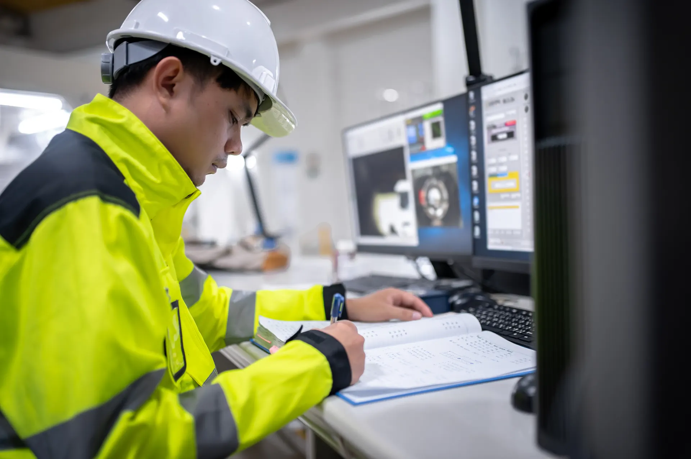

# FOEx 홈페이지

디자이너 시안을 기준으로 구 홈페이지를 다시 만든 회사 사이트입니다. 소개 페이지와 교육 신청, 문의, 회원, 관리자를 한 애플리케이션으로 구성했습니다.

사이트: https://www.foex.kr

## 역할

디자인 시안을 받아 화면을 구현하고, 회원·교육·문의·관리자 흐름과 운영 방식까지 맞췄습니다. 화면 원본은 디자이너 시안입니다.

## 범위

- 회사 소개, 사업(교육·컨설팅·엔지니어링), R&D, 제품, 홍보
- 교육 일정과 신청, 문의, Q&A
- 로그인, 이메일 인증, 마이페이지
- 공지·교육·문의를 다루는 관리자 화면

소개 문안은 언어 파일과 템플릿에 있고, 공지·교육·문의처럼 바뀌는 내용은 관리자에서 수정합니다.

## 구현

| 항목 | 선택 |
|------|------|
| 서버 | PHP 8.2, Laravel 12 |
| 화면 | Blade, Tailwind CSS, Alpine.js |
| 데이터 | MySQL |
| 빌드 | Vite |
| 언어 | 한국어 기본, 영어 전환 |
| 기준 폭 | 1920. 이 폭에서 `1rem = 10px` |

회원 로그인과 관리자 로그인은 주소가 분리되어 있습니다. 회원 확인은 이메일 인증입니다.

## 화면

홈, 컨설팅, 교육, R&D에서 쓰는 이미지입니다. 전체 페이지는 https://www.foex.kr 에서 볼 수 있습니다.

| 홈 | 컨설팅 |
|----|--------|
|  |  |

| 교육 | R&D |
|------|-----|
|  |  |
