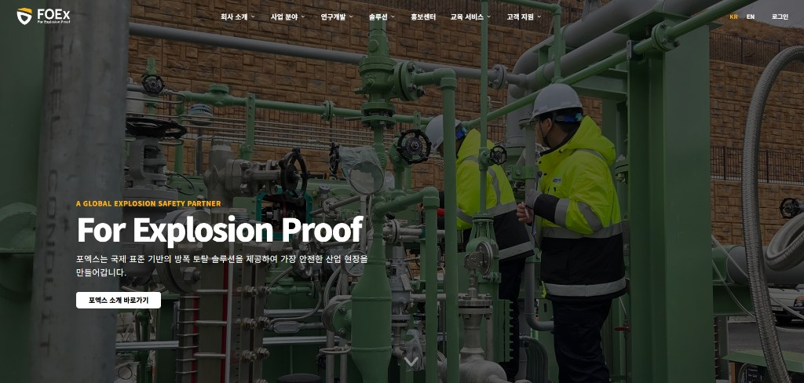
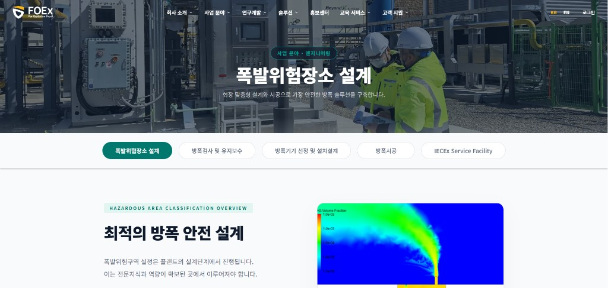
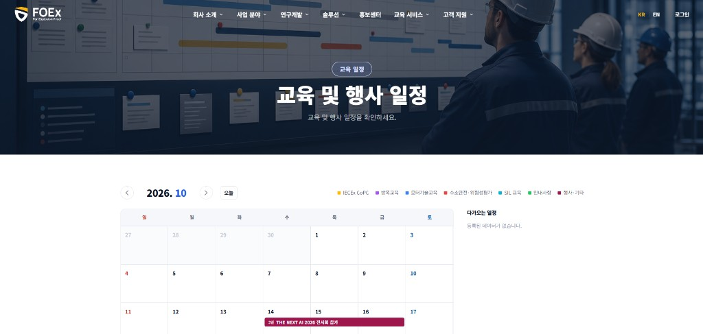
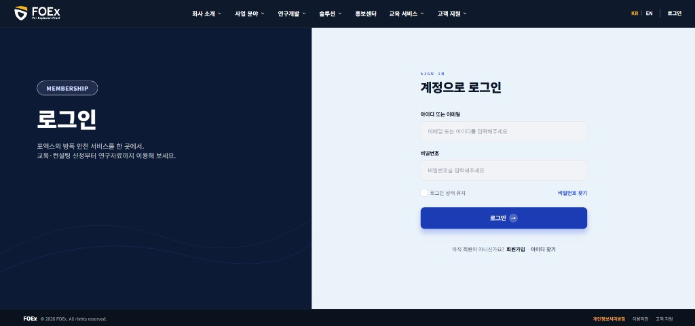
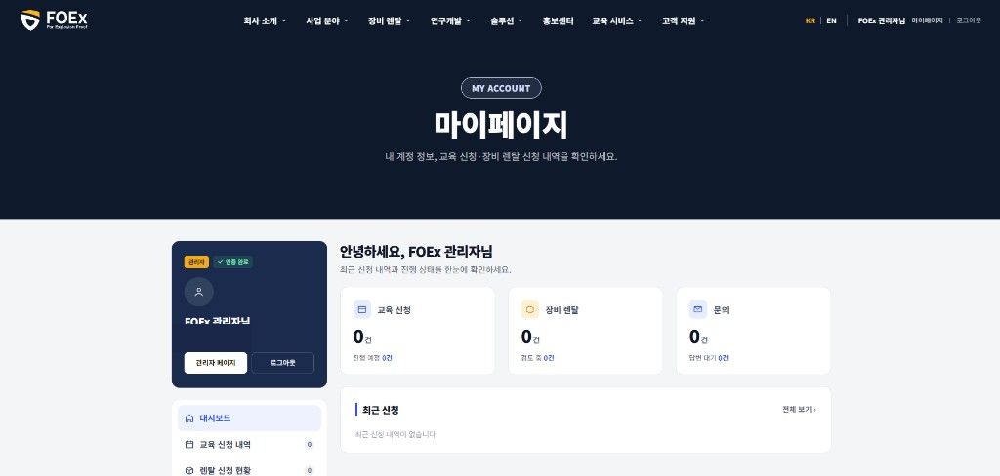
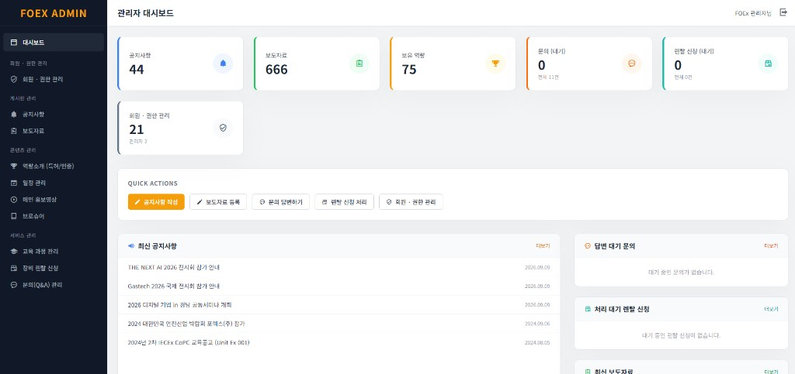

# FOEx 공식 홈페이지 리워크

구 홈페이지를 디자이너 시안 기준으로 다시 만든 회사 사이트입니다. 2026년 1월부터 10월까지 진행했고, 2026년 10월 23일에 리워크를 마쳤습니다.

**사이트** https://www.foex.kr

방폭 안전 서비스를 소개하고, 교육 신청과 문의, 회원, 관리자 업무를 한 곳에서 처리합니다.

## 무엇을 바꿨나

기존 사이트는 소개와 신청, 관리가 한 흐름으로 이어지지 않았습니다. 이번 작업은 화면을 시안에 맞추는 동시에, 방문자가 교육을 신청하고 담당자가 그 내용을 처리하는 구조까지 새로 잡았습니다.

| 구분 | 내용 |
|------|------|
| 소개 | 회사, 사업, R&D, 제품, 홍보. 시안의 폭·간격·색을 맞춤 |
| 신청 | 교육 일정, 교육 신청, 문의, Q&A |
| 회원 | 가입, 이메일 인증, 로그인, 마이페이지 |
| 운영 | 공지, 보도, 브로슈어, 교육 과정, 신청 승인, 회원, 문의 답변 |

디자인 원본은 디자이너 시안입니다. 화면 구현, 신청·회원·관리자 흐름, 다국어, 운영 반영을 맡았습니다.

## 사이트 지도

주소를 누르면 운영 사이트의 해당 화면으로 갑니다.

| 메뉴 | 주소 |
|------|------|
| 홈 | [/](https://www.foex.kr/) |
| 회사 개요, 연혁, 오시는 길 | [/company/intro](https://www.foex.kr/company/intro) |
| 교육사업. CoPC, 방폭기술, 모터 | [/business/education](https://www.foex.kr/business/education) |
| 컨설팅. 제품인증, 품질, 리스크, 표준 | [/business/consulting](https://www.foex.kr/business/consulting) |
| 엔지니어링. 설계, 검사, 선정, 시공, 설비 | [/business/engineering](https://www.foex.kr/business/engineering) |
| R&D | [/rnd/ai](https://www.foex.kr/rnd/ai) |
| FOEX Suite, FOEX Node | [/products/suite](https://www.foex.kr/products/suite) |
| 홍보센터. 공지, 보도, 브로슈어, Q&A | [/pr](https://www.foex.kr/pr) |
| 교육 일정, 교육 신청 | [/service/schedule](https://www.foex.kr/service/schedule) |
| 문의 | [/contact/inquiry](https://www.foex.kr/contact/inquiry) |
| 로그인 | [/login](https://www.foex.kr/login) |

사업 페이지는 주소 하나에서 탭으로 하위 화면이 바뀝니다. 예를 들어 엔지니어링은 설계, 방폭검사, 기기 선정, 시공, 설비 서비스가 같은 페이지 안의 탭입니다.

## 화면

1920px 폭으로 찍은 운영 화면입니다. 교육은 신청 목록 대신 일정 화면을 넣었습니다. 마이페이지의 메일 주소는 가렸습니다.

### 홈

### 엔지니어링, 폭발위험장소 설계

### 교육 일정

### 로그인

### 마이페이지

### 관리자

## 구성을 나눈 방식

소개 페이지와 운영 콘텐츠를 같은 방식으로 두지 않았습니다.

- **시안이 있는 소개 페이지**는 Blade와 언어 파일에 있습니다. 문장, 탭, 간격이 디자인과 묶여 있어서 코드를 기준으로 맞췄습니다. 한국어와 영어를 같이 둡니다.
- **자주 바뀌는 내용**은 데이터베이스와 관리자 화면으로 뺐습니다. 공지, 보도자료, 브로슈어, 홍보 영상, 교육 과정, 일정, 신청 승인, 문의 답변이 여기 해당합니다. 담당자는 배포 없이 내용을 고칩니다.

헤더, 히어로, 그 아래 탭 메뉴는 공통 컴포넌트입니다. 탭을 바꿀 때는 히어로를 다시 건드리지 않고 본문만 시안에 맞췄습니다.

## 레이아웃

데스크톱 기준 폭은 1920입니다. 이 폭에서 `1rem`이 10px가 되도록 루트 글자 크기를 뷰포트에 묶었습니다. 시안의 px 값을 rem으로 옮기면 창 너비가 조금 달라도 비율이 유지됩니다. 768px 미만에서는 모바일 글자 크기로 전환합니다.

탭 본문의 제목 줄바꿈은 시안에 있는 줄만 나누고, 문단 폭은 시안 텍스트 박스에 맞춰 두어 줄 수가 어긋나지 않게 했습니다.

## 회원과 마이페이지

회원 확인은 이메일 인증입니다. 문자 인증과 소셜 로그인은 범위에 넣지 않았습니다.

로그인 주소는 둘입니다.

- 회원 `/login`
- 관리자 `/admin/login`

관리자는 권한 레벨로 구분합니다. 마이페이지에서는 대시보드, 교육 신청 내역, 렌탈, 문의, 계정 설정을 한 화면 안에서 전환합니다. 목록에 데이터가 없어도 표 머리는 남겨 두었습니다. 계정 설정에서는 프로필, 이메일, 비밀번호, 탈퇴를 처리합니다.

## 기술

| 계층 | 사용 |
|------|------|
| 언어·런타임 | PHP 8.2 |
| 프레임워크 | Laravel 12 |
| 화면 | Blade, Tailwind CSS 3, Alpine.js |
| 데이터 | MySQL |
| 프런트 빌드 | Vite |
| 언어 | 한국어 기본, 세션으로 영어 전환 |
| 메일 | 가입 인증, 문의·교육 알림 |
| 백업 | 애플리케이션 스케줄로 일일 백업 |

장비 소개와 렌탈은 기능이 들어 있지만, 공개 여부를 설정으로 끄고 켤 수 있습니다. 일반 방문자 메뉴에는 기본으로 나오지 않습니다.

## 이 저장소에 없는 것

이 저장소는 결과와 구성을 보여 주는 포트폴리오입니다. 운영 중인 애플리케이션 소스, 환경 값, 회원 데이터는 올리지 않았습니다. 화면과 흐름은 https://www.foex.kr 에서 확인하면 됩니다. 로그인 이후 화면은 계정이 있어야 합니다.
